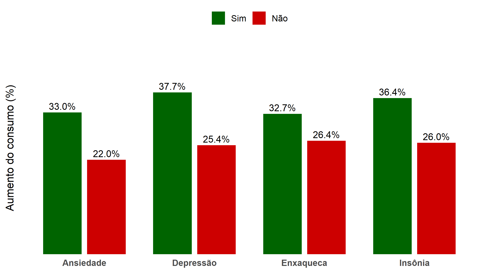
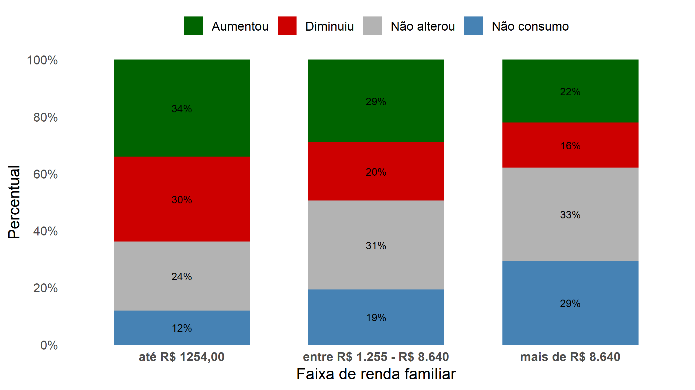
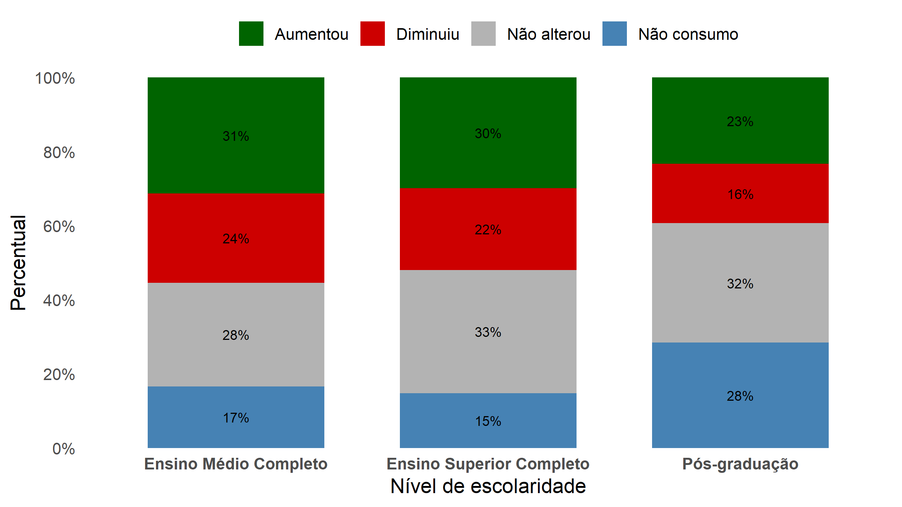
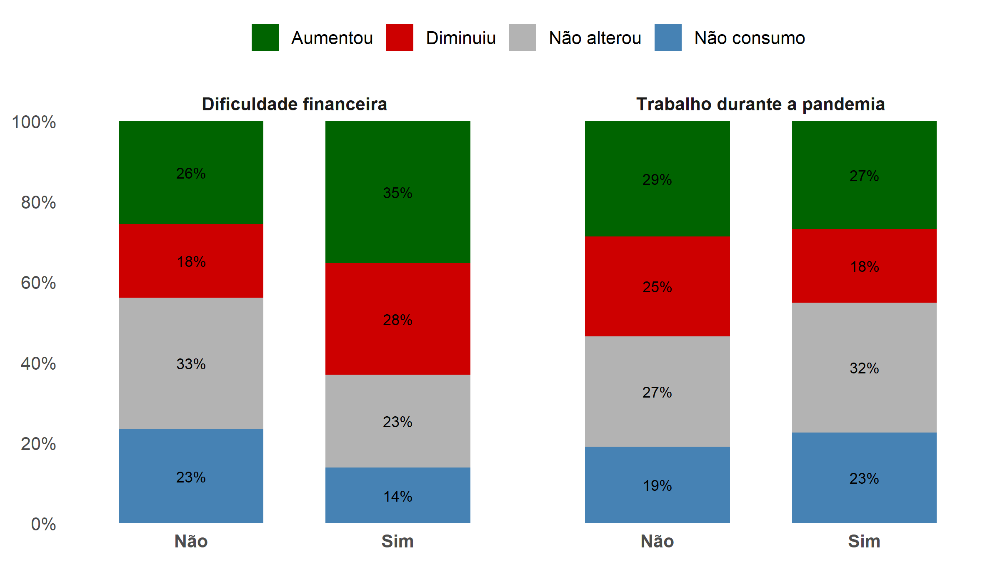
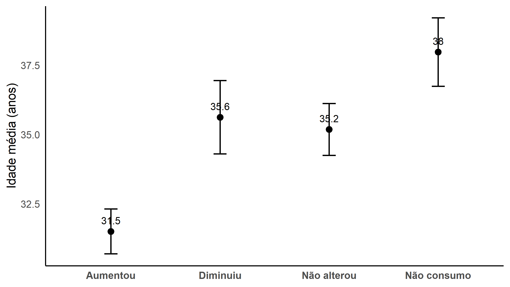
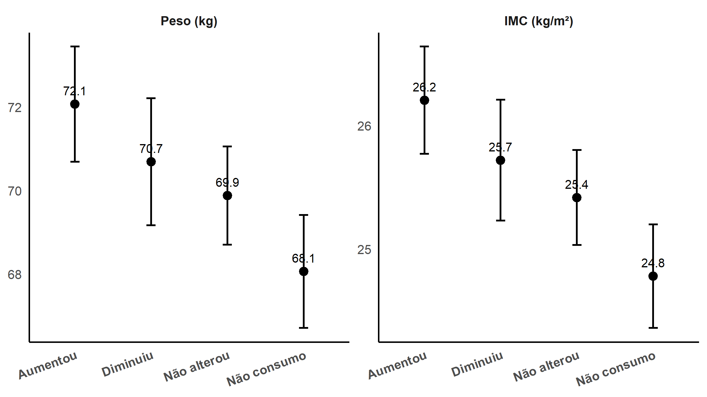

```{r}
#| include: false

require(openxlsx)            # Leitura de base de dados
require(gt)
require(gtsummary)
require(dplyr)
require(ggplot2)
require(qqplotr)
require(DescTools)
require(rstatix)
require(tidyr)
require(scales)

setwd("C:/Users/Alexandre Roque/OneDrive/Área de Trabalho/Prática Estatística 2/Projeto I")

dados=read.xlsx("Nutrição.xlsx")

### Variáveis qualitativas

dados_quali = dados %>% 
  select(Genero, Raca_cor, Regiao:cigarro, Ansiedade:Enxaqueca, Produtos_Industrializados)

dados_quali = dados_quali %>% 
  filter(Genero != "Outro",
         Genero != "Prefiro não responder")

dados_quali = dados_quali %>% 
  mutate(
    Raca_cor = case_when(
      Raca_cor %in% c("Outro","Prefiro não declarar") ~"Outros/Prefiro não declarar",
      Raca_cor %in% c("Indígena","Amarela") ~"Indígena/Amarela",
      TRUE ~ Raca_cor
    )
  )

dados_quali = dados_quali %>% 
  filter(Escolaridade != "Analfabeto",
         Escolaridade != "Ensino Fundamental Completo",
         Escolaridade != "Não desejo informar")


dados_quali <- dados_quali %>%
  mutate(
    Raca_cor = factor(
      Raca_cor,
      levels = c(
        "Branca",
        "Preta",
        "Parda",
        "Indígena/Amarela",
        "Outros/Prefiro não declarar"
      )
    )
  )

dados_quali |>
  count(Genero) |>
  mutate(
    Proporcao = n / sum(n),
    Percentual = 100 * Proporcao
  )

dados_quali |>
  count(Escolaridade) |>
  mutate(
    Proporcao = n / sum(n),
    Percentual = 100 * Proporcao
  )

dados_quali |>
  count(Renda_familiar) |>
  mutate(
    Proporcao = n / sum(n),
    Percentual = 100 * Proporcao
  )

dados_quali |>
  count(Raca_cor) |>
  mutate(
    Proporcao = n / sum(n),
    Percentual = 100 * Proporcao
  )


variaveis <- c(
  "Ansiedade",
  "Depressao",
  "Insonia",
  "Enxaqueca"
)

dados_grafico <- dados_quali |>
  select(Produtos_Industrializados, all_of(variaveis)) |>
  pivot_longer(
    cols = all_of(variaveis),
    names_to = "Variavel",
    values_to = "Resposta"
  ) |>
  filter(
    Resposta %in% c("Sim", "Não"),
    Produtos_Industrializados %in% c("Aumentou", "Diminuiu",
                                     "Não alterou", "Não consumo")
  ) |>
  group_by(Variavel, Resposta) |>
  summarise(
    Percentual = mean(
      Produtos_Industrializados == "Aumentou"
    ) * 100,
    .groups = "drop"
  ) |>
  mutate(
    Variavel = recode(
      Variavel,
      Ansiedade = "Ansiedade",
      Depressao = "Depressão",
      Insonia = "Insônia",
      Enxaqueca = "Enxaqueca"
    )
  )

dados_grafico <- dados_grafico |>
  mutate(Resposta = factor(Resposta, levels = c("Sim", "Não")))

grafico_emocional = ggplot(
  dados_grafico,
  aes(x = Variavel, y = Percentual, fill = Resposta)
) +
  geom_col(
    position = position_dodge(width = 0.8),
    width = 0.7
  ) +
  geom_text(
    aes(label = sprintf("%.1f%%", Percentual)),
    position = position_dodge(width = 0.8),
    vjust = -0.4,
    size = 4
  ) +
  scale_fill_manual(
  values = c(
    "Sim" = "darkgreen",
    "Não" = "red3"
  )
) +
  scale_y_continuous(
    labels = label_number(suffix = "%", decimal.mark = ","),
    limits = c(0, 45),
    breaks = seq(0, 45, 5),
    expand = expansion(mult = c(0, 0.1))
  ) +
  labs(
    x = NULL,
    y = "Aumento do consumo (%)",
    fill = NULL
  ) +
  theme_minimal(base_size = 13) +
  theme(
    legend.position = "top",
    axis.text.y = element_blank(),
    panel.grid = element_blank(),
    axis.text.x = element_text(face = "bold")
  )

ggsave("emocionais.png", grafico_emocional, width = 8, height = 4.5, dpi = 300)


dados_grafico <- dados_quali |>
  filter(
    !is.na(Renda_familiar),
    !is.na(Produtos_Industrializados)
  ) |>
  count(Renda_familiar, Produtos_Industrializados) |>
  group_by(Renda_familiar) |>
  mutate(Percentual = n / sum(n)) |>
  ungroup() |>
  mutate(
    Produtos_Industrializados = factor(
      Produtos_Industrializados,
      levels = c(
        "Aumentou",
        "Diminuiu",
        "Não alterou",
        "Não consumo"
      )
    )
  )

grafico_renda = ggplot(
  dados_grafico,
  aes(
    x = Renda_familiar,
    y = Percentual,
    fill = Produtos_Industrializados
  )
) +
  geom_col(position = "fill", width = 0.7) +
  geom_text(
  aes(label = percent(Percentual, accuracy = 1)),
  position = position_fill(vjust = 0.5),
  size = 3,
  color = "black"
) +
  scale_y_continuous(
    labels = percent_format(),
    breaks = seq(0, 1, 0.2),
    expand = c(0, 0)
  ) +
  scale_fill_manual(
    values = c(
      "Aumentou" = "darkgreen",
      "Diminuiu" = "red3",
      "Não alterou" = "grey70",
      "Não consumo" = "steelblue"
    )
  ) +
  labs(
    x = "Faixa de renda familiar",
    y = "Percentual",
    fill = NULL
  ) +
  theme_minimal(base_size = 13) +
  theme(
    legend.position = "top",
    axis.text.x = element_text(face = "bold"),
    panel.grid = element_blank()
  )

ggsave("rendafamiliar.png", grafico_renda, width = 8, height = 4.5, dpi = 300)

dados_grafico <- dados_quali |>
  filter(
    !is.na(Escolaridade),
    !is.na(Produtos_Industrializados)
  ) |>
  count(Escolaridade, Produtos_Industrializados) |>
  group_by(Escolaridade) |>
  mutate(Percentual = n / sum(n)) |>
  ungroup() |>
  mutate(
    Produtos_Industrializados = factor(
      Produtos_Industrializados,
      levels = c(
        "Aumentou",
        "Diminuiu",
        "Não alterou",
        "Não consumo"
      )
    )
  )

grafico_escolaridade = ggplot(
  dados_grafico,
  aes(
    x = Escolaridade,
    y = Percentual,
    fill = Produtos_Industrializados
  )
) +
  geom_col(position = "fill", width = 0.7) +
  geom_text(
  aes(label = percent(Percentual, accuracy = 1)),
  position = position_fill(vjust = 0.5),
  size = 3,
  color = "black"
) +
  scale_y_continuous(
    labels = percent_format(),
    breaks = seq(0, 1, 0.2),
    expand = c(0, 0)
  ) +
  scale_fill_manual(
    values = c(
      "Aumentou" = "darkgreen",
      "Diminuiu" = "red3",
      "Não alterou" = "grey70",
      "Não consumo" = "steelblue"
    )
  ) +
  labs(
    x = "Nível de escolaridade",
    y = "Percentual",
    fill = NULL
  ) +
  theme_minimal(base_size = 13) +
  theme(
    legend.position = "top",
    axis.text.x = element_text(face = "bold"),
    panel.grid = element_blank()
  )

ggsave("escolaridade.png", grafico_escolaridade, width = 8, height = 4.5, dpi = 300)

dados_grafico <- dados_quali |>
  select(
    Produtos_Industrializados,
    Dificuldade_Financeira,
    Trabalha
  ) |>
  pivot_longer(
    cols = c(Dificuldade_Financeira, Trabalha),
    names_to = "Variavel",
    values_to = "Grupo"
  ) |>
  filter(
    !is.na(Grupo),
    !is.na(Produtos_Industrializados)
  ) |>
  count(Variavel, Grupo, Produtos_Industrializados) |>
  group_by(Variavel, Grupo) |>
  mutate(Percentual = n / sum(n)) |>
  ungroup() |>
  mutate(
    Variavel = recode(
      Variavel,
      Dificuldade_Financeira = "Dificuldade financeira",
      Trabalha = "Trabalho durante a pandemia"
    ),
    Produtos_Industrializados = factor(
      Produtos_Industrializados,
      levels = c(
        "Aumentou", "Diminuiu",
        "Não alterou", "Não consumo"
      )
    )
  )

grafico_dif_trab = ggplot(
  dados_grafico,
  aes(
    x = Grupo,
    y = Percentual,
    fill = Produtos_Industrializados
  )
) +
  geom_col(position = "fill", width = 0.7) +
  geom_text(
    aes(label = percent(Percentual, accuracy = 1)),
    position = position_fill(vjust = 0.5),
    size = 3,
    color = "black"
  ) +
  facet_wrap(~Variavel) +
  scale_y_continuous(
    labels = percent_format(),
    breaks = seq(0, 1, 0.2),
    expand = c(0, 0)
  ) +
  scale_fill_manual(
    values = c(
      "Aumentou" = "darkgreen",
      "Diminuiu" = "red3",
      "Não alterou" = "grey70",
      "Não consumo" = "steelblue"
    )
  ) +
  labs(
    x = NULL,
    y = NULL,
    fill = NULL
  ) +
  theme_minimal(base_size = 13) +
  theme(
    legend.position = "top",
    panel.grid = element_blank(),
    axis.text.x = element_text(face = "bold"),
    strip.text = element_text(face = "bold")
  )

ggsave("dificuldade_trabalho.png", grafico_dif_trab, width = 8, height = 4.5, dpi = 300)


### Variáveis quantitativas

dados_quanti = dados %>% 
  select(Idade, Peso, Altura, IMC, Produtos_Industrializados)


ggplot(dados_quanti, aes(x = Idade)) +
  geom_density(fill = "blue", alpha = 0.6) +
  facet_wrap(~ Produtos_Industrializados) +
  xlab("Idade") +
  ylab("Densidade") +
  theme_bw() +
  theme(text = element_text(size = 14))

ggplot(dados_quanti, aes(sample = Idade)) +
    stat_qq_band(fill="lightblue") +
    stat_qq_line() +
    stat_qq_point() +
    facet_wrap(~Produtos_Industrializados,scales = "free")+
    xlab("Quantis Teoricos")+
    ylab("Quantis Amostrais")+
    theme_bw() +
    theme(text = element_text(size = 14))

by(dados_quanti$Idade, dados_quanti$Produtos_Industrializados, shapiro.test)

ggplot(dados_quanti, aes(x = Peso)) +
  geom_density(fill = "blue", alpha = 0.6) +
  facet_wrap(~ Produtos_Industrializados) +
  xlab("Peso") +
  ylab("Densidade") +
  theme_bw() +
  theme(text = element_text(size = 14))

ggplot(dados_quanti, aes(sample = Peso)) +
    stat_qq_band(fill="lightblue") +
    stat_qq_line() +
    stat_qq_point() +
    facet_wrap(~Produtos_Industrializados,scales = "free")+
    xlab("Quantis Teoricos")+
    ylab("Quantis Amostrais")+
    theme_bw() +
    theme(text = element_text(size = 14))

by(dados_quanti$Peso, dados_quanti$Produtos_Industrializados, shapiro.test)

ggplot(dados_quanti, aes(x = Altura)) +
  geom_density(fill = "blue", alpha = 0.6) +
  facet_wrap(~ Produtos_Industrializados) +
  xlab("Altura") +
  ylab("Densidade") +
  theme_bw() +
  theme(text = element_text(size = 14))

ggplot(dados_quanti, aes(sample = Altura)) +
    stat_qq_band(fill="lightblue") +
    stat_qq_line() +
    stat_qq_point() +
    facet_wrap(~Produtos_Industrializados,scales = "free")+
    xlab("Quantis Teoricos")+
    ylab("Quantis Amostrais")+
    theme_bw() +
    theme(text = element_text(size = 14))

by(dados_quanti$Altura, dados_quanti$Produtos_Industrializados, shapiro.test)

ggplot(dados_quanti, aes(x = IMC)) +
  geom_density(fill = "blue", alpha = 0.6) +
  facet_wrap(~ Produtos_Industrializados) +
  xlab("IMC") +
  ylab("Densidade") +
  theme_bw() +
  theme(text = element_text(size = 14))

ggplot(dados_quanti, aes(sample = IMC)) +
    stat_qq_band(fill="lightblue") +
    stat_qq_line() +
    stat_qq_point() +
    facet_wrap(~Produtos_Industrializados,scales = "free")+
    xlab("Quantis Teoricos")+
    ylab("Quantis Amostrais")+
    theme_bw() +
    theme(text = element_text(size = 14))

by(dados_quanti$IMC, dados_quanti$Produtos_Industrializados, shapiro.test)

LeveneTest(formula = Idade~Produtos_Industrializados,data = dados_quanti)

LeveneTest(formula = Peso~Produtos_Industrializados,data = dados_quanti)

LeveneTest(formula = Altura~Produtos_Industrializados,data = dados_quanti)

LeveneTest(formula = IMC~Produtos_Industrializados,data = dados_quanti)

variaveis <- c("Idade", "Peso", "Altura", "IMC")

for (v in variaveis) {
  modelo <- lm(
    as.formula(paste(v, "~ Produtos_Industrializados")),
    data = dados_quanti
  )

  cat("\nVariável:", v, "\n")
  print(by(
    residuals(modelo),
    dados_quanti$Produtos_Industrializados,
    shapiro.test
  ))
}

tbl_summary(
  data = dados_quanti,
  by = Produtos_Industrializados,
  statistic = all_continuous() ~ "{mean} ({sd})"
) |>
  add_p(
    test = all_continuous() ~ "oneway.test",
    test.args = all_continuous() ~ list(var.equal = FALSE)
  )

games_howell_test(Idade~Produtos_Industrializados,
                  data=dados_quanti)

games_howell_test(Peso~Produtos_Industrializados,
                  data=dados_quanti)

games_howell_test(IMC~Produtos_Industrializados,
                  data=dados_quanti)

dados_idade <- dados_quanti |>
  filter(
    !is.na(Idade),
    !is.na(Produtos_Industrializados)
  ) |>
  group_by(Produtos_Industrializados) |>
  summarise(
    n = n(),
    media = mean(Idade),
    dp = sd(Idade),
    erro = qt(0.975, df = n - 1) * dp / sqrt(n),
    ic_inf = media - erro,
    ic_sup = media + erro,
    .groups = "drop"
  ) |>
  mutate(
    Produtos_Industrializados = factor(
      Produtos_Industrializados,
      levels = c(
        "Aumentou",
        "Diminuiu",
        "Não alterou",
        "Não consumo"
      )
    )
  )

grafico_idade = ggplot(
  dados_idade,
  aes(x = Produtos_Industrializados, y = media)
) +
  geom_errorbar(
    aes(ymin = ic_inf, ymax = ic_sup),
    width = 0.12,
    linewidth = 0.7
  ) +
  geom_point(size = 3) +
  geom_text(
    aes(label = round(media, 1)),
    vjust = -1,
    size = 4
  ) +
  labs(
    x = NULL,
    y = "Idade média (anos)"
  ) +
  theme_minimal(base_size = 14) +
  theme(
    panel.grid = element_blank(),
    axis.text.x = element_text(face = "bold"),
    axis.line = element_line(color = "black")
  )

ggsave("idade.png", grafico_idade, width = 8, height = 4.5, dpi = 300)

dados_peso_imc <- dados_quanti |>
  filter(!is.na(Produtos_Industrializados)) |>
  pivot_longer(
    cols = c(Peso, IMC),
    names_to = "Variavel",
    values_to = "Valor"
  ) |>
  filter(!is.na(Valor)) |>
  group_by(Variavel, Produtos_Industrializados) |>
  summarise(
    n = n(),
    media = mean(Valor),
    dp = sd(Valor),
    erro = qt(0.975, df = n - 1) * dp / sqrt(n),
    ic_inf = media - erro,
    ic_sup = media + erro,
    .groups = "drop"
  ) |>
  mutate(
  Produtos_Industrializados = factor(
    Produtos_Industrializados,
    levels = c(
      "Aumentou", "Diminuiu",
      "Não alterou", "Não consumo"
    )
  ),
  Variavel = recode(
    Variavel,
    Peso = "Peso (kg)",
    IMC = "IMC (kg/m²)"
  ),
  Variavel = factor(
    Variavel,
    levels = c("Peso (kg)", "IMC (kg/m²)")
  )
)

grafico_pesoIMC = ggplot(
  dados_peso_imc,
  aes(x = Produtos_Industrializados, y = media)
) +
  geom_errorbar(
    aes(ymin = ic_inf, ymax = ic_sup),
    width = 0.12,
    linewidth = 0.7
  ) +
  geom_point(size = 3) +
  geom_text(
    aes(label = round(media, 1)),
    vjust = -1,
    size = 3.5
  ) +
  facet_wrap(~Variavel, scales = "free_y") +
  labs(
    x = NULL,
    y = NULL
  ) +
  theme_minimal(base_size = 13) +
  theme(
    panel.grid = element_blank(),
    axis.text.x = element_text(
      angle = 20,
      hjust = 1,
      face = "bold"
    ),
    strip.text = element_text(face = "bold"),
    axis.line = element_line(color = "black")
  )

ggsave("peso_IMC.png", grafico_pesoIMC, width = 8, height = 4.5, dpi = 300)


```


```{r}
#| include: false

## Investigando os valores esperados

chisq.test(dados_quali$Genero,dados_quali$Produtos_Industrializados)$expected #Pearson

chisq.test(dados_quali$Raca_cor,dados_quali$Produtos_Industrializados)$expected #Pearson

chisq.test(dados_quali$Regiao,dados_quali$Produtos_Industrializados)$expected #Pearson

chisq.test(dados_quali$Isolamento,dados_quali$Produtos_Industrializados)$expected #Pearson

chisq.test(dados_quali$Trabalha,dados_quali$Produtos_Industrializados)$expected #Pearson

chisq.test(dados_quali$Renda_familiar,dados_quali$Produtos_Industrializados)$expected #Pearson

chisq.test(dados_quali$Escolaridade,dados_quali$Produtos_Industrializados)$expected #Pearson

chisq.test(dados_quali$Covid,dados_quali$Produtos_Industrializados)$expected #Pearson

chisq.test(dados_quali$Consulta_Nutricionista,dados_quali$Produtos_Industrializados)$expected #Pearson

chisq.test(dados_quali$Dificuldade_Financeira,dados_quali$Produtos_Industrializados)$expected #Pearson

chisq.test(dados_quali$cigarro,dados_quali$Produtos_Industrializados)$expected #Pearson

chisq.test(dados_quali$Ansiedade,dados_quali$Produtos_Industrializados)$expected #Pearson

chisq.test(dados_quali$Depressao,dados_quali$Produtos_Industrializados)$expected #Pearson

chisq.test(dados_quali$Insonia,dados_quali$Produtos_Industrializados)$expected #Pearson

chisq.test(dados_quali$Enxaqueca,dados_quali$Produtos_Industrializados)$expected #Pearson


```


``` {r}
#| include: false

###################### ANÁLISE DAS QUALITATIVAS

chisq.test(dados_quali$Raca_cor,dados_quali$Produtos_Industrializados)$stdres

# Diminuiu X Preta (maior que o esperado)

# Não consumo X Branca (maior que o esperado)
# Não consumo X Preta (menor do que o esperado)

chisq.test(dados_quali$Regiao,dados_quali$Produtos_Industrializados)$stdres

# Aumentou X Nordeste (maior que o esperado)
# Aumentou X Norte (maior que o esperado)
# Aumentou X Sudeste (menor que o esperado)

# Não alterou X Centro-Oeste (maior que o esperado)

chisq.test(dados_quali$Isolamento,dados_quali$Produtos_Industrializados)$stdres

# Não alterou X sem isolamento (maior que o esperado)
# Não alterou X com isolamento (menor que o esperado)

chisq.test(dados_quali$Trabalha,dados_quali$Produtos_Industrializados)$stdres

# Diminuiu X Não trabalha (maior que o esperado)
# Diminuiu X Trabalha (menor que o esperado)

# Não alterou X Não trabalha (menor que o esperado)
# Não alterou X Trabalha (maior que o esperado)

chisq.test(dados_quali$Renda_familiar,dados_quali$Produtos_Industrializados)$stdres

# Aumentou X até R$ 1254,00 (maior que o esperado)
# Aumentou X entre R$ 1.255 - R$ 8.640 (maior que o esperado)
# Aumentou X mais de R$ 8.640 (menor que o esperado)

# Diminuiu X até R$ 1254,00 (maior que o esperado)
# Diminuiu X mais de R$ 8.640 (menor que o esperado)

# Não alterou X até R$ 1254,00 (menor que o esperado)

# Não consumo X até R$ 1254,00 (menor que o esperado)
# Não consumo X entre R$ 1.255 - R$ 8.640 (menor que o esperado)
# Não consumo X mais de R$ 8.640 (maior que o esperado)

chisq.test(dados_quali$Escolaridade,dados_quali$Produtos_Industrializados)$stdres
 
# Aumentou X Ensino Médio Completo (maior que o esperado)
# Aumentou X Pós-graduação (menor que o esperado)

# Diminuiu X Ensino Médio Completo (maior que o esperado)
# Diminuiu X Pós-graduação (menor que o esperado)

# Não alterou X Ensino Médio Completo (menor que o esperado)

# Não consumo X Ensino Médio Completo (menor que o esperado)
# Não consumo X Ensino Superior Completo (menor que o esperado)
# Não consumo X Pós-graduação (maior que o esperado)

chisq.test(dados_quali$Consulta_Nutricionista,dados_quali$Produtos_Industrializados)$stdres

# Aumentou X Não consultou (maior que o esperado)
# Aumentou X Consultou (menor que o esperado)

# Diminuiu X Não consultou (menor que o esperado)
# Diminuiu X Consultou (maior que o esperado)

# Não alterou X Não consultou (maior que o esperado)
# Não alterou X Consultou (menor que o esperado)

# Não consumo X Não consultou (menor que o esperado)
# Não consumo X Consultou (maior que o esperado)

chisq.test(dados_quali$Dificuldade_Financeira,dados_quali$Produtos_Industrializados)$stdres

# Aumentou X Não relatou (menor que o esperado)
# Aumentou X Relatou (maior que o esperado)

# Diminuiu X Não relatou (menor que o esperado)
# Diminuiu X Relatou (maior que o esperado)

# Não alterou X Não relatou (maior que o esperado)
# Não alterou X Relatou (menor que o esperado)

# Não consumo X Não relatou (maior que o esperado)
# Não consumo X Relatou (menor que o esperado)

chisq.test(dados_quali$Ansiedade,dados_quali$Produtos_Industrializados)$stdres

# Aumentou X Sem ansiedade (menor que o esperado)
# Aumentou X Com ansiedade (maior que o esperado)

# Não alterou X Sem ansiedade (maior que o esperado)
# Não alterou X Com ansiedade (menor que o esperado)

# Não consumo X Sem ansiedade (maior que o esperado)
# Não consumo X Com ansiedade (menor que o esperado)

chisq.test(dados_quali$Depressao,dados_quali$Produtos_Industrializados)$stdres

# Aumentou X Sem depressão (menor que o esperado)
# Aumentou X Com depressão (maior que o esperado)

# Não alterou X Sem depressão (maior que o esperado)
# Não alterou X Com depressão (menor que o esperado)  

chisq.test(dados_quali$Insonia,dados_quali$Produtos_Industrializados)$stdres

# Aumentou X Sem insônia (menor que o esperado)
# Aumentou X Com insônia (maior que o esperado)

# Não consumo X Sem insônia (maior que o esperado)
# Não consumo X Com insônia (menor que o esperado)

chisq.test(dados_quali$Enxaqueca,dados_quali$Produtos_Industrializados)$stdres

# Aumentou X Sem enxaqueca (menor que o esperado)
# Aumentou X Com enxaqueca (maior que o esperado)

# Não alterou X Sem enxaqueca (maior que o esperado)
# Não alterou X Com enxaqueca (menor que o esperado)


```


``` {r}
#| include: false

######################## QUALITATIVA

# Função que calcula o coeficiente de Cramer
cramer_fun <- function(data, variable, by, ...) {
  tab <- table(data[[variable]], data[[by]])
  v <- DescTools::CramerV(tab, conf.level = NA)

  tibble::tibble(cramer = round(v, 3))
}

# tabela qualitativa final

tabela_quali = 
  tbl_summary(data = dados_quali,
            by = Produtos_Industrializados,
            percent = "row",
            label = list(
              Genero ~ "Sexo",
              Raca_cor ~ "Raça",
              Regiao ~ "Região",
              Isolamento ~"Estava fazendo isolamento",
              Trabalha ~ "Trabalhou durante a pandemia",
              Renda_familiar ~ "Renda familiar",
              Escolaridade ~"Nível de escolaridade",
              Covid ~"Teve diagnóstico de Covid",
              Consulta_Nutricionista ~"Consultou um nutricionista",
              Dificuldade_Financeira ~"Relatou dificuldade financeira",
              cigarro ~"Hábito de fumar",
              Ansiedade ~"Relatou ansiedade",
              Depressao ~"Relatou depressão",
              Insonia ~"Relatou insônia",
              Enxaqueca ~"Relatou enxaqueca"
            )
)%>%
  add_p(pvalue_fun = label_style_pvalue(digits = 3)) %>%
  bold_p(t = 0.05) %>%
  add_stat(fns = everything() ~ cramer_fun)%>%
  modify_spanning_header(all_stat_cols() ~ "**Produtos industrializados**") %>%
  modify_header(label ~ "**Variáveis**") %>%
  bold_labels() %>%
  modify_header(all_stat_cols() ~ "**{level}**<br>{n} ({style_percent(p)}%)<sup>1</sup>") %>%
modify_header(p.value ~ "**p-valor**<sup>2</sup>") %>%

  modify_footnote(everything() ~ NA) %>%
  
  as_gt() %>%
  tab_style(
    style = cell_text(color = "red"),
    locations = cells_body(
    columns = stat_1,
     rows = (variable == "Regiao" & label=="Sudeste")|
      (variable == "Renda_familiar" & label == "mais de R$ 8.640")|
      (variable == "Escolaridade" & label == "Pós-graduação")|
      (variable == "Consulta_Nutricionista" & label == "Sim")|
      (variable == "Dificuldade_Financeira" & label == "Não")|
      (variable == "Ansiedade" & label == "Não")|
      (variable == "Depressao" & label == "Não")|
      (variable == "Insonia" & label == "Não")|
      (variable == "Enxaqueca" & label == "Não")
    )) %>%
  
  tab_style(
    style = cell_text(color = "red"),
    locations = cells_body(
    columns = stat_2,
    rows = (variable == "Trabalha" & label=="Sim")|
      (variable == "Renda_familiar" & label == "mais de R$ 8.640")|
      (variable == "Escolaridade" & label == "Pós-graduação")|
      (variable == "Consulta_Nutricionista" & label == "Não")|
      (variable == "Dificuldade_Financeira" & label == "Não")
    )) %>%
  
  tab_style(
    style = cell_text(color = "red"),
    locations = cells_body(
    columns = stat_3,
    rows = (variable == "Isolamento" & label=="Sim")|
      (variable == "Trabalha" & label == "Não")|
      (variable == "Renda_familiar" & label == "até R$ 1254,00")|
      (variable == "Escolaridade" & label == "Ensino Médio Completo")|
      (variable == "Consulta_Nutricionista" & label == "Sim")|
      (variable == "Dificuldade_Financeira" & label == "Sim")|
      (variable == "Ansiedade" & label == "Sim")|
      (variable == "Depressao" & label == "Sim")|
      (variable == "Enxaqueca" & label == "Sim")
    )) %>%
  
  tab_style(
    style = cell_text(color = "red"),
    locations = cells_body(
    columns = stat_4,
    rows = (variable == "Raca_cor" & label=="Preta")|
      (variable == "Renda_familiar" & label == "até R$ 1254,00" | label == "entre R$ 1.255 - R$ 8.640")|
      (variable == "Escolaridade" & label == "Ensino Médio Completo" | label == "Ensino Superior Completo")|
      (variable == "Consulta_Nutricionista" & label == "Não")|
      (variable == "Dificuldade_Financeira" & label == "Sim")|
      (variable == "Ansiedade" & label == "Sim")|
      (variable == "Insonia" & label == "Sim")
    )) %>%
  
  tab_style(
    style = cell_text(color = "darkgreen"),
    locations = cells_body(
    columns = stat_1,
    rows = (variable == "Regiao" & label=="Nordeste" | label=="Norte")|
      (variable == "Renda_familiar" & label == "até R$ 1254,00"|label=="entre R$ 1.255 - R$ 8.640")|
      (variable == "Escolaridade" & label == "Ensino Médio Completo")|
      (variable == "Consulta_Nutricionista" & label == "Não")|
      (variable == "Dificuldade_Financeira" & label == "Sim")|
      (variable == "Ansiedade" & label == "Sim")|
    (variable == "Depressao" & label == "Sim")|
    (variable == "Insonia" & label == "Sim")|
    (variable == "Enxaqueca" & label == "Sim")
    )) %>%
  
  tab_style(
    style = cell_text(color = "darkgreen"),
    locations = cells_body(
    columns = stat_2,
    rows = (variable == "Raca_cor" & label=="Preta")|
      (variable == "Trabalha" & label == "Não")|
      (variable == "Renda_familiar" & label == "até R$ 1254,00")|
      (variable == "Escolaridade" & label == "Ensino Médio Completo")|
      (variable == "Consulta_Nutricionista" & label == "Sim")|
      (variable == "Dificuldade_Financeira" & label == "Sim")
    )) %>%
  
  tab_style(
    style = cell_text(color = "darkgreen"),
    locations = cells_body(
    columns = stat_3,
    rows = (variable == "Regiao" & label=="Centro-oeste")|
      (variable == "Isolamento" & label == "Não")|
      (variable == "Trabalha" & label == "Sim")|
      (variable == "Consulta_Nutricionista" & label == "Não")|
      (variable == "Dificuldade_Financeira" & label == "Não")|
      (variable == "Ansiedade" & label == "Não")|
      (variable == "Depressao" & label == "Não")|
      (variable == "Enxaqueca" & label == "Não")
    )) %>%
  
  tab_style(
    style = cell_text(color = "darkgreen"),
    locations = cells_body(
    columns = stat_4,
    rows = (variable == "Raca_cor" & label=="Branca")|
      (variable == "Renda_familiar" & label == "mais de R$ 8.640")|
      (variable == "Escolaridade" & label == "Pós-graduação")|
      (variable == "Consulta_Nutricionista" & label == "Sim")|
      (variable == "Dificuldade_Financeira" & label == "Não")|
      (variable == "Ansiedade" & label == "Não")|
      (variable == "Insonia" & label == "Não")
    ))%>%
tab_options(
  table.font.size = "23px",
  column_labels.font.size = "25px",
  heading.title.font.size = "50px",
  container.height = px(600),
  container.overflow.y = TRUE
)%>%
  
  tab_style(
  style = cell_text(size = px(30)),
  locations = cells_column_spanners()
)%>%
  
  tab_source_note(
  source_note = md(
    "*1* n (%)<br>
     *2* Teste qui-quadrado de Pearson<br>
     <span style='color:darkgreen'><b>Verde:</b></span> maior frequência que a esperada<br>
     <span style='color:red'><b>Vermelho:</b></span> menor frequência que a esperada"
  )
) %>%
  
  cols_label(
  cramer = md("**Cramér**"),
  p.value = md("**p-valor **<sup>2</sup>")
)

tabela_quali


```

```{r}
#| include: false

######################## QUANTITATIVA

## tabela quantitativa final

tabela_quanti = tbl_summary(data = dados_quanti,
            by = Produtos_Industrializados,
            statistic = all_continuous() ~ "{mean} ({sd})",
            label = list(
                  Idade ~ "Idade (anos)",
                  Peso ~ "Peso (kg)",
                  Altura ~ "Altura (metros)",
                  IMC ~"IMC (kg/m<sup>2</sup>)")
            )%>%
  add_p(
    test = all_continuous() ~ "oneway.test",
    test.args = all_continuous() ~ list(var.equal = FALSE),
    pvalue_fun = label_style_pvalue(digits = 3)
  )%>%
bold_p(t = 0.05) %>%
modify_spanning_header(all_stat_cols() ~ "**Média (DP) por categorias de Produtos industrializados**") %>%
modify_header(label ~ "**Variáveis**") %>%
bold_labels() %>%
  
  modify_header(all_stat_cols() ~ "**{level}**<br>{n} ({style_percent(p)}%)<sup>1</sup>") %>%
modify_header(p.value ~ "**p-valor**<sup>2</sup>") %>%

modify_footnote(everything() ~ NA)%>%
as_gt() %>%                   
fmt_markdown(columns = label) %>%
  tab_source_note(
  source_note = md( "*1* n (%)<br>
     *2* ANOVA de Welch")
)%>%
tab_options(
  table.font.size = "23px",
  column_labels.font.size = "25px",
  heading.title.font.size = "50px"
)%>%
  tab_style(
  style = cell_text(size = px(30)),
  locations = cells_column_spanners()
)

tabela_quanti
```

# Contexto 

## Pandemia e alimentação 

::: box-grey 

- **Isolamento social** e **crise econômica** alteraram a rotina:
  
  - Mais refeições em casa;
  - Compras mais espaçadas e maior estoque de alimentos;
  - Ansiedade e estresse influenciando o comer;
  
- A pandemia mudou o que, quanto e como comemos.

:::

- **Produtos industrializados**: práticos, baratos e duráveis.


## Variável resposta e problema

::::: box-grey 

**Consumo de produtos industrializados**
 
:::: {.columns}
::: {.column width="50%"}
- Aumentou
- Diminuiu
:::
::: {.column width="50%"}
- Não alterou
- Não consome
:::
::::

:::::

- **Problema da pesquisa**: 
  - Quais fatores estão associados à mudança no consumo de industrializados na pandemia?

## Objetivos

::: box-grey 

- **Principal**

  - Avaliar a associação entre a mudança no consumo de industrializados e as demais variáveis

- **Secundários**

  - Descrever o padrão de mudança no consumo
  - Comparar grupos sociodemográficos e econômicos
  - Avaliar o papel da pandemia e da saúde emocional
  
:::

# Metodologia

## Dados e amostra 

::: box-grey

- Questionário online aplicado em 2022
- Coleta feita por alunas da pós-graduação em Nutrição da UFF
- $n = 2155$ indivíduos adultos

::: 

## Variáveis explicativas

::: box-grey

- **Qualitativas**

  - *Sociodemográficas*: gênero, raça, região e escolaridade
  - *Econômicas*: trabalho, renda familiar e dificuldade financeira
  - *Pandemia*: isolamento e Covid-19
  - *Saúde e hábitos*: consulta com nutricionista e cigarro
  - *Emocionais*: ansiedade, depressão, insônia e enxaqueca

- **Quantitativas**

  - Idade, peso, altura e IMC

:::


# Variáveis qualitativas 

## Métodos estatísticos

::: box-greypeq
1. **Pressuposto verificado**: frequências esperadas ≥ 5
2. **Qui-quadrado de Pearson**: associação com a variável resposta ($p < 0,05$)
3. **V de Cramér**: intensidade da associação
4. **Resíduos padronizados**: onde está a associação ($|resíduo| > 1,96$)
:::
 
## Tabela 1

```{r}
tabela_quali
```

## V de Crámer
:::: box-greypeq2

| Variável     | p-valor        | Crámer   |
|:----------------|-----------------:|:-----------:|
| Dificuldade financeira    | <0,001 | <span style="background-color:#f4a261; padding:4px 8px;">0,150</span>   |
| Consulta a nutricionista     | <0,001       | <span style="background-color:#f4a261; padding:4px 8px;">0,140</span>   |
| Ansiedade    | <0,001      | <span style="background-color:#F5B270; padding:4px 8px;">0,127</span>   |
| Escolaridade    | <0,001 | <span style="background-color:#F5B270; padding:4px 8px;">0,126</span>    |
| Renda familiar     | <0,001       | <span style="background-color:#F5B270; padding:4px 8px;">0,124</span>   |
| Depressão    | <0,001      | <span style="background-color:#F5BA78; padding:4px 8px;">0,103</span>    |
| <span style="white-space: nowrap;">Trabalho durante a pandemia</span>     | 0,002       | <span style="background-color:#F6CA88; padding:4px 8px;">0,084</span>   |
| Insônia    | 0,002      | <span style="background-color:#F6CA88; padding:4px 8px;">0,084</span>   |
| Isolamento    | 0,012      | <span style="background-color:#F7DA98; padding:4px 8px;">0,072</span>   |

::::

## Visão geral 

::: box-grey

- **Consumo de industrializados**: 27% aumentaram, 20% diminuíram, 31% não alteraram, 22% não consomem
- 12 das 15 variáveis estão associadas ao consumo de industrializados 
  - Sem associação: sexo, Covid-19 e cigarro
- **Associações fracas**: V de Cramér de no máximo 0,15

:::

## Aspectos emocionais: mais aumento do consumo

{fig-align="center" width="80%"}

## Renda familiar

:::: {.columns}
::: {.column width="70%"}
{fig-align="center" width="100%"}
:::
::: {.column width="30%"}

<div class="texto-baixo4">
::::: box-peq2
- Até R$ 1.254: mais mudanças no consumo
- Mais de R$ 8.640: tendência a não consumo
:::::
</div>  
:::
::::


## Escolaridade

:::: {.columns}
::: {.column width="70%"}
{fig-align="center" width="100%"}
:::
::: {.column width="30%"}

<div class="texto-baixo">
::::: box-peq2

- Pós-graduação: tendência a não consumo

:::::
</div>
:::
::::

## Dificuldade financeira e trabalho

:::: {.columns}
::: {.column width="70%"}
{fig-align="center" width="100%"}
:::
::: {.column width="30%"}

<div class="texto-baixo3">

::::: box-peq2

- Mais aumento e mais diminuição do consumo
- Menos “não alterou” e menos “não consome”
- Quem não trabalhou diminuiu mais o consumo

- **Condições piores: mais mudança no consumo**

:::::

</div>

:::
::::


## Outros fatores 

::::: box-peq2


|  | Aumentou | Diminuiu | Não alterou | Não consome |
|:---|:---:|:---:|:---:|:---:|
| Consultou nutricionista | 20% [↓]{.down} | 25% [↑]{.up} | 24% [↓]{.down} | 31% [↑]{.up} |
| Isolamento | | | 28% [↓]{.down} | |
| Raça: preta | | 30% [↑]{.up} | | 13% [↓]{.down} |
| Raça: branca | | | | 23% [↑]{.up} |
| Nordeste | 34% [↑]{.up} | | | |
| Norte | 33% [↑]{.up} | | | |
| Centro-Oeste | | | 38% [↑]{.up} | |

[↑]{.up} acima do esperado <br>
[↓]{.down} abaixo do esperado <br>

::::: 

# Variáveis quantitativas

## Métodos estatísticos

::: box-grey
1. **Shapiro-Wilk**: normalidade rejeitada 
2. **Levene**: variâncias diferentes entre as categorias 
3. **ANOVA de Welch**: diferença entre as médias das categorias, sem exigir variâncias iguais 
4. **Games-Howell**: quais pares de categorias diferem 
:::

- Nível de significância: 5% 

## Tabela 2 
```{r}
tabela_quanti  
```

## Idade

::::: {.columns}

:::: {.column width="70%"}
{fig-align="center" width="100%"}
::::

:::: {.column width="30%"}

<div class="texto-baixo4">
::: box-peq2

- “Aumentou” difere de todos os outros grupos

:::
</div>

::::

:::::

## Peso e IMC

{fig-align="center" width="80%"}

# Conclusão

## Objetivo 

::: box-grey
Avaliar a associação entre a mudança no consumo de industrializados e as demais variáveis
:::

- **Principais achados:**
  - 15 das 19 variáveis associadas ao consumo de industrializados
  - Associações de pequena magnitude

## Quem aumentou o consumo?

::: box-greypeq2

- Ansiedade, depressão, insônia e enxaqueca
- Dificuldade financeira, renda baixa e ensino médio
- Mais jovens (32 anos), com peso e IMC maiores
- Sem consulta com nutricionista
- Norte e Nordeste

:::

::: box-peq

- Em contraste:

  - **Não consome:** mais velhos, IMC menor, renda alta, pós-graduação e consulta com nutricionista
  - **Diminuiu:** também com dificuldade financeira e renda baixa, mas sem fatores emocionais

:::

## 

::::: box-greypeq2
:::: {.columns}

::: {.column width="50%"}
::: {style="text-align: center;font-size: 1.3em;"}
**Interpretações**
:::

- **Recursos limitados:** o consumo muda conforme preço e praticidade
- **Estresse emocional: **alimento como conforto em um período difícil
- **Informação e acompanhamento: **mais escolha sobre o que consumir
:::

::: {.column width="50%"}
::: {style="text-align: center;font-size: 1.3em;"}
**Limitações**
:::
- Estudo transversal: associação, não causa
- Amostra de conveniência: quase metade tem pós-graduação, cerca de 75% são do sexo feminino
- Generalização limitada dos resultados
:::
::::
:::::

# Obrigado!